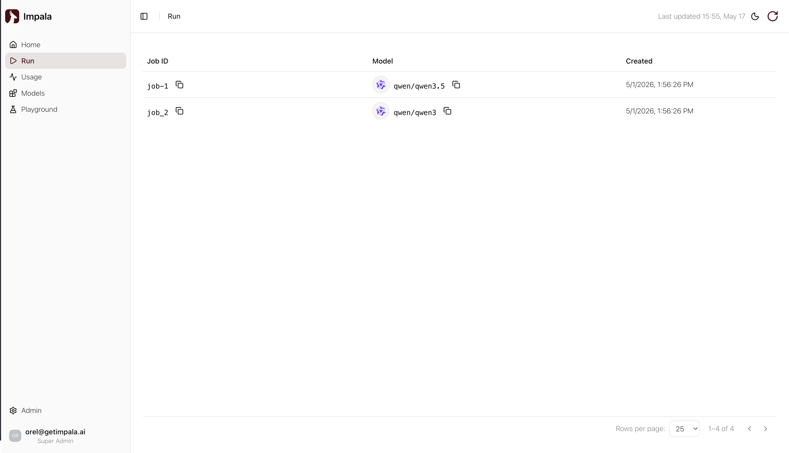
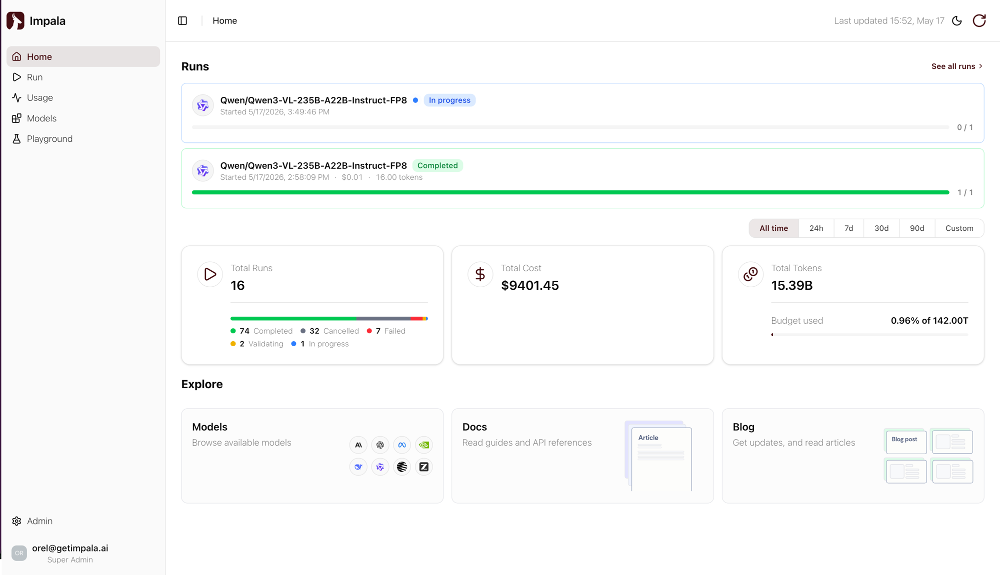
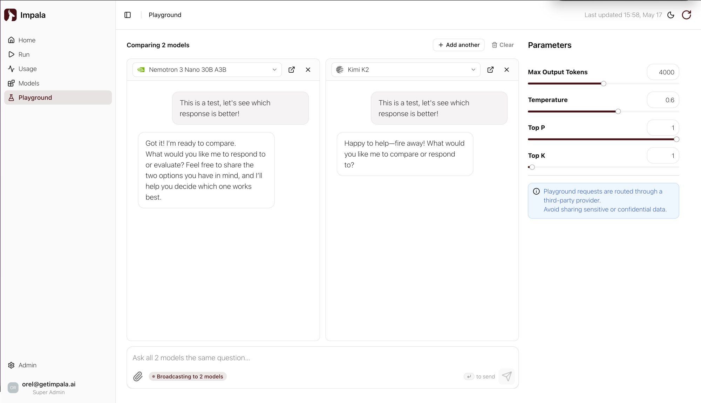
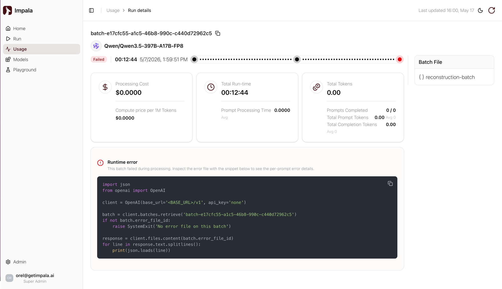
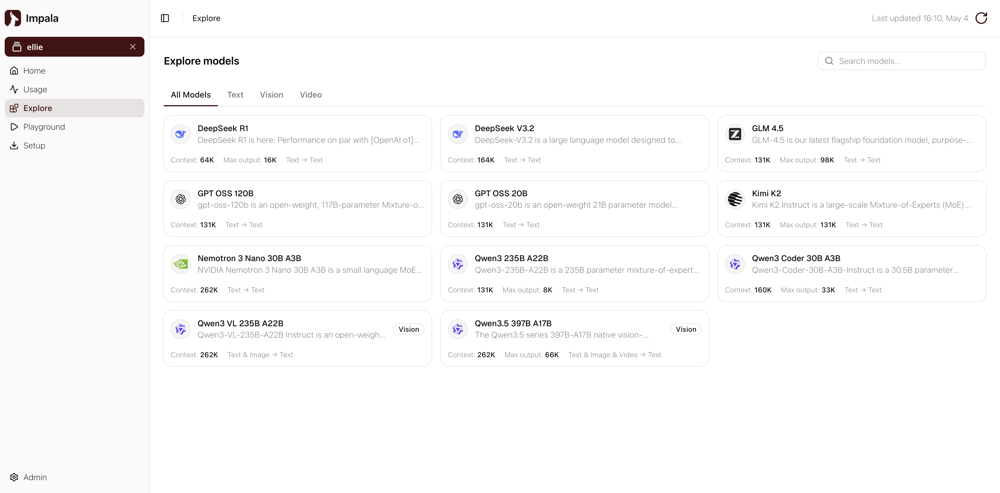

<Update label="November 19, 2026">
  ### Requests stop when your client disconnects

  When your client disconnects before Impala starts sending a response, Impala now stops the request instead of generating to completion. This covers non-streaming requests, and streaming requests before their first chunk. An SDK retry after a timeout therefore starts over, so raise your timeout rather than relying on retries. See [Timeouts and retries](/send-a-request#timeouts-and-retries).
</Update>

<Update label="November 15, 2026">
  ### Price list for committed-usage plans

  Committed-usage plans are now billed per model at the prices on your price list. Once Impala has set up your committed-usage billing, [`GET /v1/account/prices`](/billing-api#get-prices) returns that list, as it does on pay-as-you-go.
</Update>

<Update label="November 5, 2026">
  ### Unknown job IDs fail the batch

  A batch whose `job_id` names no job now fails with the error code `workload_resolution_rejected` and the message `Job not found: <job_id>`. Before, it ran on a configuration Impala picked from the batch's shape. See [Jobs](/jobs-and-job-ids#using-a-job-id).
</Update>

<Update label="November 3, 2026">
  ### Batches on fine-tuned LoRA adapters

  You can now run a batch on your own LoRA fine-tune. Upload the adapter to your data plane's resources bucket and set `model` to `ft:<base-model>:<adapter-name>`. A fine-tuned batch is billed as its base model, at the base model's rate and size. BYOC data planes need a release that includes this change. See [LoRA adapters in batch](/lora-batch).
</Update>

<Update label="October 22, 2026">
  ### Rate limit on the Usage page

  The Throughput chart on the Usage page now draws your RPM limit as a dashed line. On a single model, the line shows the lower of your team limit and that model's own limit. The chart also plots your busiest minute and marks time buckets with `429` rejections as red dots. See [See your limit on the Usage page](/rate-limit-webhooks#see-your-limit-on-the-usage-page).
</Update>

<Update label="October 21, 2026">
  ### Running batches report their cost so far

  A running batch now shows its cost so far instead of null. On the batch object, `processing_cost` is the sum of the batch's parts priced yet while the new `cost_status` field is `pending`. It's null only before any part is priced. `cost_status` turns `final` about 1–2.5 minutes after the batch's last part ends, rather than waiting for every batch that shared its hardware to finish. `price_1m_tokens` likewise shows the price per million tokens so far, computed over the parts priced yet.

  On the dashboard, total cost now includes pending runs' costs so far, so it can still change while any run's cost is pending.

  Cost fields appear only for teams that are shown pricing.
</Update>

<Update label="October 20, 2026">
  ### Scale to zero on by default for new BYOC data planes

  New Bring Your Own Cloud data planes now scale to zero when idle. Workloads scale down to zero replicas and no scaler-managed GPU instances keep running. Submitting a batch wakes the region, so the first batch after an idle period waits for it to start. To opt out, contact your Impala account team. See [Scale to zero](/deployment-options#scale-to-zero).
</Update>

<Update label="October 11, 2026">
  ### Billing API

  Pull your usage, spend and prices as JSON with the same API key you use for inference. See [Billing API](/billing-api).
</Update>

<Update label="October 7, 2026">
  ### Spend by model

  The billing card in [Settings](https://platform.getimpala.ai/settings) now includes a **Spend by model** table. It shows your spend per model for this month and last month, plus each model's share of the total. Pay-as-you-go spend is visible to team admins only.

  ### Cumulative spend chart

  The Settings billing card also plots your cumulative spend for this month against last month. When an estimate is available, the chart adds a projected month-end total so you can see where the month is heading.

  ### Usage counts each request once

  The Usage page now counts each request you send once.

  Failed requests are split into two groups:

  - **Request errors**: `4xx` responses caused by the request itself.
  - **Service errors**: failures on Impala's side, including timeouts.

  The requests chart plots request errors and service errors as separate lines.

  ### Rate-limited requests on the Usage page

  Requests rejected with HTTP `429` by your API key's or team's rate limit now appear on the Usage page as request errors. Impala attributes these rejections to the model you requested, so each model's figures include its own rate-limited requests. The failure breakdown also lists rate-limited requests as their own row. To follow limit changes automatically, see [Rate limit webhooks](/rate-limit-webhooks).
</Update>

<Update label="May 17, 2026">
  ### Run Tab

  A dedicated tab listing every job ID in your workspace, with one-click copy on each row. Pair it with the [batch API](https://docs.getimpala.ai/run-your-first-batch) to launch runs straight from your code without hunting for IDs.

  <Frame>
    
  </Frame>

  ### Home Tab

  Real-time visibility into every run alongside aggregate metrics for total runs, cost, tokens, and run-status breakdown. Filter the view by 24h, 7d, 30d, 90d, or a custom range to focus on the window that matters.

  <Frame>
    
  </Frame>

  ### Playground Model Comparison

  Compare responses from up to four models side-by-side in a single prompt. Broadcast one message to every selected model concurrently and pick the one that fits your use case.

  <Frame>
    
  </Frame>

  ### Batch Error Review

  When a batch fails, the run details view surfaces the runtime error inline along with a ready-to-copy snippet for pulling the full error file via the API. A faster path from a failed run to a fix.

  <Frame>
    
  </Frame>
</Update>

<Update label="May 3, 2026">
  ### Cross-Region Image URI

  Run a batch in region X with the source file uploaded to S3 in region Y — your JSONL and the data plane no longer need to be in the same region. Fewer prerequisites to run batches on Impala.

  ### Explore Models

  Browse a catalog of models in-app and view the details of each one. Includes quick links to Playground for easy model testing.

  <Frame>
    
  </Frame>
</Update>
